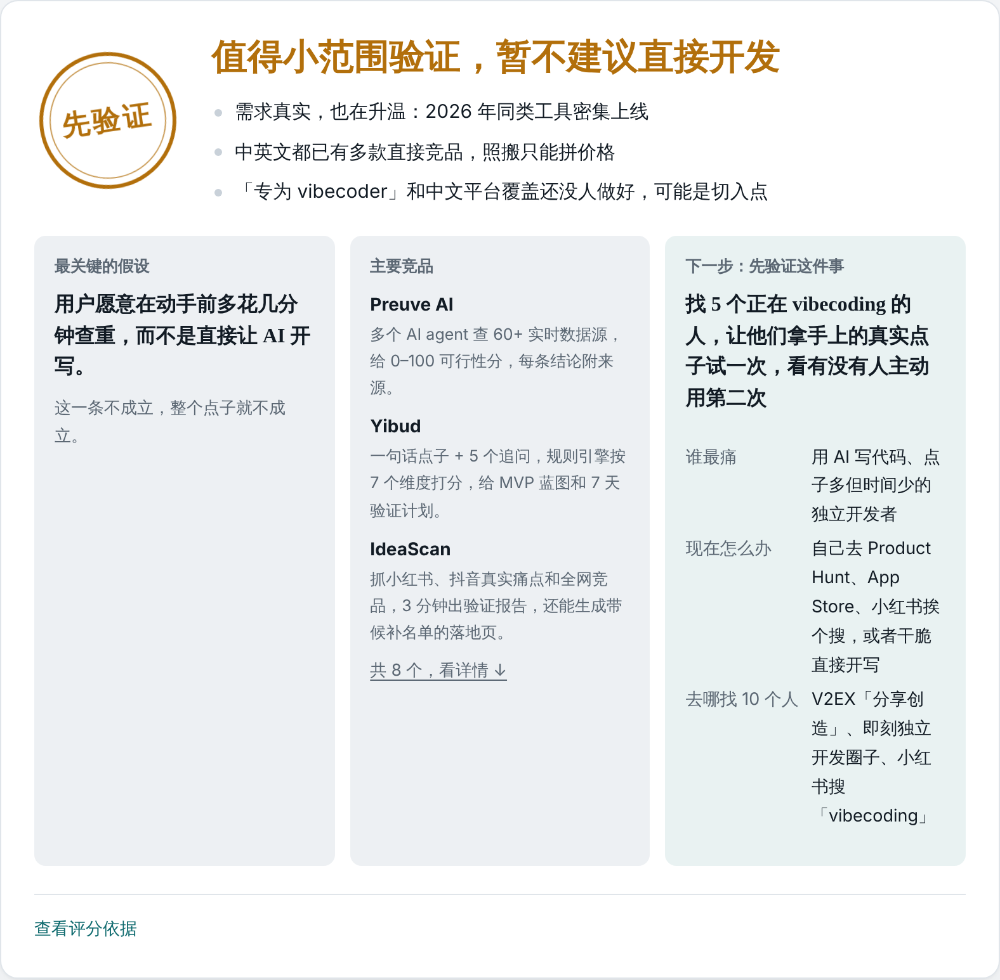
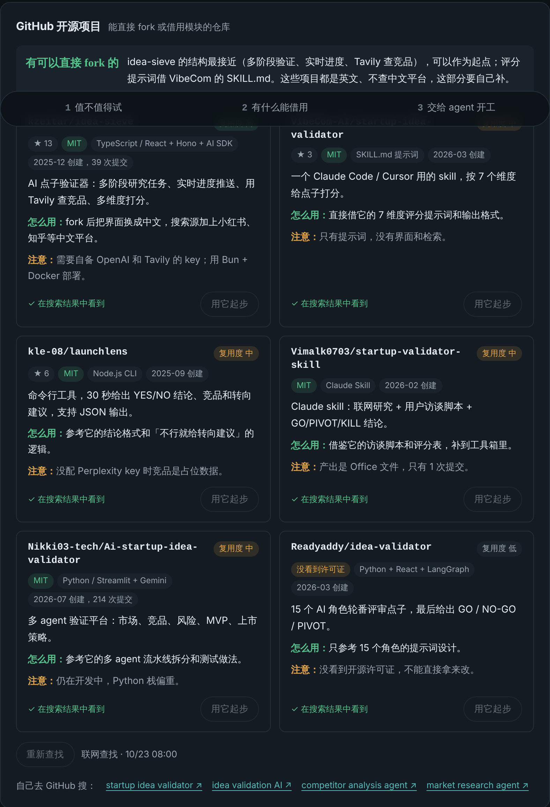

# 点子雷达 · Idea Radar

> 帮独立开发者在动手前查清竞品，再找到可复用的开源项目，最后生成一份可执行的开发简报。

在 vibecoding 的时代，谁都能把一个点子做成网站、小程序或 App。可常见的情况是：花了时间、精力和 AI 额度做出来，才发现市面上早有同类，而且做得更好。点子雷达让你在写第一行代码之前，先花几分钟查一遍。

## 三步主线

**1. 值不值得试**

报告第一屏是一张决策卡：

- 一句能照着做的结论，例如「值得小范围验证，暂不建议直接开发」
- 2–3 条关键原因
- 最关键的假设：这一条不成立，整个点子就不成立
- 主要竞品
- 下一步先验证什么：谁最痛、他们现在怎么解决、去哪找 10 个这样的人、一周内能做完的一件小事

竞品详情、用户的好评和吐槽、第一批用户在哪、差异化切入点、市场与趋势、盲点与风险都折叠在下面，想深入时再展开。评分收在「查看评分依据」里：六个维度各 0–10 分，总分按公开的固定权重计算。

**2. 有什么能借用**

- 竞品身上可以借鉴的做法
- 按需去 GitHub 找相似的开源项目：显示 star 数、许可证、复用度，没有许可证或 GPL 类许可证会标黄提醒；点「用它起步」可以针对某个仓库生成改造方案

**3. 交给 agent 开工**

先划清第一版「必须有 / 先别做」，再把整份分析整理成开发简报，交给编程 agent：

| agent | 项目说明文件 |
|---|---|
| Claude Code | `CLAUDE.md` |
| Codex | `AGENTS.md` |
| WorkBuddy / CodeBuddy | `CODEBUDDY.md` |
| Cursor | `AGENTS.md` |
| Trae | `.trae/rules/project.md` |
| Gemini CLI | `GEMINI.md` |
| GitHub Copilot | `.github/copilot-instructions.md` |
| 其他 | `AGENTS.md` |

可以复制成一段提示词直接粘贴，也可以下载成对应的项目说明文件，页面会给出终端命令和操作步骤。

**其他**

- 联网检索：结论附出处，搜索失败时自动退回不联网分析并说明原因
- 工具箱：起名、落地页文案、一句话卖点、冷启动帖子、用户访谈提纲
- 对报告继续追问
- 历史记录，导出 Markdown 或单独的报告网页

## 怎么运行

点子雷达是一个单文件网页（`index.html`），设计运行在 [Claude](https://claude.ai) 的 Artifact 环境里，分析功能通过页面中的 `window.claude` 调用：

| 能力 | 用途 |
|---|---|
| `sample` | 让 Claude 生成分析、工具箱内容和追问回答 |
| `mcp` | 调用搜索连接器联网检索：Parallel Search、Tavily、Exa，或 Claude 桌面版内置浏览器 |
| `downloads` | 下载报告和项目说明文件 |

- **在 claude.ai 里用**：把 `index.html` 交给 Claude，让它发布成 Artifact，并开启 `sample` 和 `downloads` 能力。想联网检索，还需要开启 `mcp` 能力，并在 claude.ai 的连接器设置里连上一个搜索连接器（Parallel Search 免费，不用注册账号）。
- **直接用浏览器打开**：能看到完整界面和示例报告，但没有 Claude 运行环境，不能分析新的点子。

分析用的是使用者自己的 Claude 额度。

## 数据与隐私

- 历史记录只保存在使用者浏览器的 localStorage 里，不上传到任何服务器
- 页面本身不收集任何数据

## 已知局限

- 不联网时，分析只依据模型已有的知识，可能漏掉最近上线的产品，也可能出错。每个竞品都标了置信度并附核实链接，重要结论请自己再搜一遍。
- 评分是模型对六个方面的判断，不是客观测量，适合理解结论从哪来，不适合拿去和别的点子比高低。
- 各 agent 读取哪个项目说明文件，依据的是 2026 年 10 月的官方文档，以后可能变化。

## 许可证

[MIT](LICENSE)
